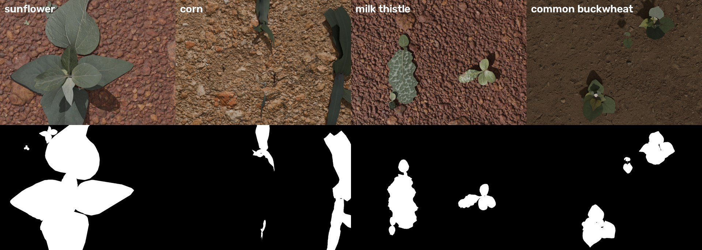
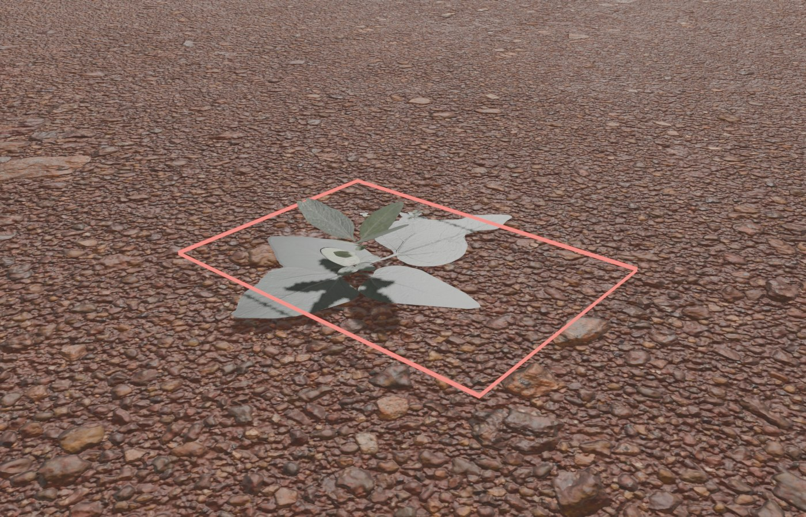
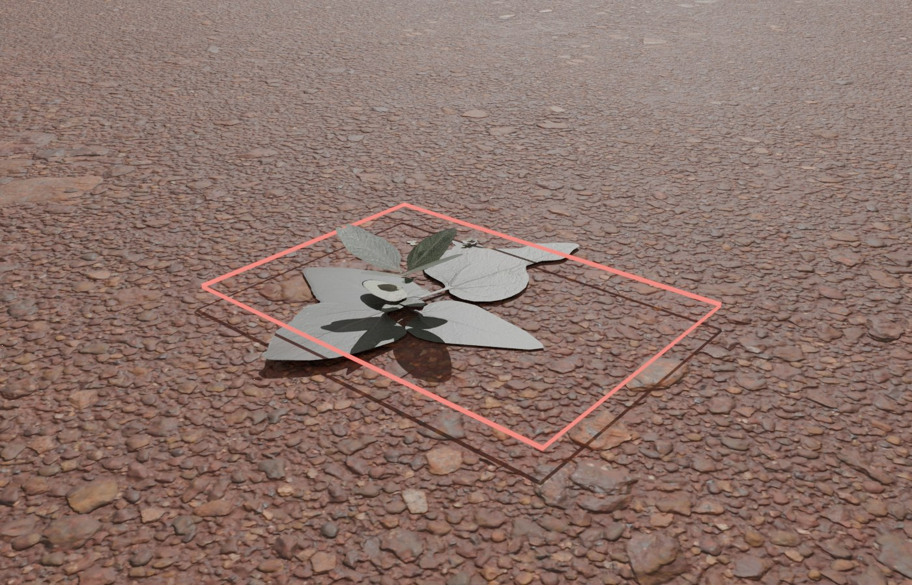

# AgriSyn Generator

Blender pipeline that builds and renders **AgriSyn**, a synthetic dataset of top-down images of
four crop and weed species with pixel-exact segmentation masks, made to train semantic
segmentation models that are evaluated on real field images (the
[WE3DS](https://www.mdpi.com/1424-8220/23/5/2713) dataset).

Each image is a procedurally composed 3D scene: a photographic soil plane, one or more plants
assembled from a library of 3D leaf models, a sun lamp under a Nishita sky and a nadir camera.
The scene is rendered twice with Cycles, once as an RGB image and once with flat emission
materials to get the mask.




| Composed scene as seen in Blender (EEVEE material preview) | The same scene rendered with Cycles                  |
| ---------------------------------------------------------- | ---------------------------------------------------- |
|  |  |

The red frame on the ground is the area seen by the nadir camera (64.8 × 46.3 cm).

The published dataset is on Zenodo: **AgriSyn**
([doi:10.5281/zenodo.23752147](https://doi.org/10.5281/zenodo.23752147)), 12,000 images
in three variants (10, 30 and 50 leaf models per species). This repository is the code that
generated it, and it reproduces the published images exactly with the default seed.

## How a scene is built

1. **Ground.** One of ten ready-made soil planes (Poly Haven PBR textures with displacement) is
   copied from the library, randomly rotated and scaled so that the camera footprint is always
   inside it.
2. **Plants.** The number of plants (1-4, or 1-5 for milk thistle and buckwheat) is drawn from a
   distribution calibrated on the WE3DS training split. Each plant is a stack of leaf
   "crosses": leaves copied at random from the species library, arranged around the stem with
   increasing tilt from the bottom cross to the top one. A per-plant scale factor (log-uniform,
   calibrated per species) is applied, and the plant is placed at a random position inside the
   footprint, seated on the local relief of the soil.
3. **Light.** A sun lamp with random energy (3-6), angular size, inclination (45-75° from the
   zenith) and azimuth, under a Nishita sky with random sun elevation (35-65°) and strength
   (0.2-0.5).
4. **Camera.** Nadir camera 90 cm above the ground, 50 mm lens on a 36 mm sensor,
   1600 × 1144 px, seeing 64.8 × 46.3 cm of ground: the acquisition geometry of WE3DS
   (0.4 mm per pixel). The whole scene is at real scale, in metres.
5. **Render.** Cycles, 64 samples, AgX view transform, no denoising. The mask is a second
   render with white emission on plants and black on the ground, thresholded to a binary PNG.

Everything is driven by Python's `random` seeded with `seed + scene_id`, so any scene can be
rebuilt on its own.

## Requirements

- [Blender](https://www.blender.org/) 4.5 LTS (tested with 4.5.8). No extra Python packages:
  the script runs inside Blender's bundled Python (NumPy included).
- A GPU is optional. Cycles uses the first available backend (Metal, OptiX, CUDA, HIP, oneAPI)
  and falls back to CPU. On an Apple M-series GPU one 1600 × 1144 image takes about 3 s.
- The leaf library `blender/agrisyn.blend` (1.3 GB, see below).

## Repository layout

```
.
├── main.py                 # entry point: generate | compose | render
├── agrisyn/
│   ├── config.py           # soil planes, camera optics, leaf catalogue, plant distribution
│   ├── builders/           # GroundBuilder and one PlantBuilder subclass per species
│   ├── scene/
│   │   ├── compose.py      # compose_scene, reset_scene, save_scene
│   │   ├── render.py       # Cycles setup, image + mask rendering
│   │   ├── camera.py       # nadir camera
│   │   └── light.py        # sun + Nishita sky
│   ├── masks.py            # binary mask writer (8-bit PNG)
│   └── metadata.py         # metadata.csv
├── blender/
│   └── agrisyn.blend       # leaf and ground libraries (not tracked by git, see below)
└── docs/img/               # images used in this README
```

### The Blender library

`blender/agrisyn.blend` holds everything the generator copies from:


| Collection         | Content                                                                                    |
| ------------------ | ------------------------------------------------------------------------------------------ |
| `ground`           | 10 soil planes, one per texture, with material and displacement already set                |
| `sunflower`        | 50 leaf models:`sunflower_big_01..12`, `sunflower_medium_01..18`, `sunflower_small_01..20` |
| `corn`             | `corn_1..49`                                                                               |
| `milk_thistle`     | `milk_thistle_000..049`                                                                    |
| `common_buckwheat` | `common_buckwheat_000..049`                                                                |

All textures are packed inside the file, so it is self-contained. Because of its size (GitHub
does not accept files larger than 100 MB in a repository) it is ignored by git (`.gitignore`)
and is distributed as an asset of the
[`v1.0` release](https://github.com/CarlosModinez/agrisyn-generator/releases/tag/v1.0) of
this repository. Download `agrisyn.blend` from the release page and place it at
`blender/agrisyn.blend`, or from the command line:

```bash
mkdir -p blender
curl -L -o blender/agrisyn.blend \
  https://github.com/CarlosModinez/agrisyn-generator/releases/download/v1.0/agrisyn.blend
shasum -a 256 blender/agrisyn.blend
# 51f88374fa9298333b24edf7a025183d4023a47b3128880a587050332a3e2baa
```

The file is not part of the Zenodo record, which holds only the rendered dataset.

## Step by step

All commands run Blender in background mode (`-b`) with this script; the generator's own
arguments come after `--`. Run them from the repository root.

### 1. Compose and render (the full pipeline)

```bash
blender -b blender/agrisyn.blend -P main.py -- generate \
    --leaf-count 50 --species corn --range-start 0 --range-end 10 --output-dir renders
```

For every scene id in the range this composes the scene, renders the image and the mask and
appends a row to `metadata.csv`:

```
renders/renders_50/corn/
├── images/0.png … 9.png     RGB, 1600 × 1144
├── masks/0.png … 9.png      8-bit, 0 = ground, 255 = plant
└── metadata.csv
```

Scenes whose image and mask already exist are skipped, so an interrupted run can be relaunched
with the same command. Omit `--species` to generate all four species.

### 2. Compose only (inspect the scene in Blender)

```bash
blender -b blender/agrisyn.blend -P main.py -- compose \
    --leaf-count 50 --species sunflower --range-start 2 --range-end 3 --output-dir scenes
```

This builds the scene and saves it as `scenes/renders_50/sunflower/2.blend`, a self-contained
file (about 90 MB: the leaf and ground libraries are dropped, only the objects of the scene are
kept, with camera, sun and sky). Open it in Blender to look at the composition, tweak it, or
take screenshots. The scene description (species, seed, number of plants, soil, sun angles,
scales) is stored in the file as a custom property of the scene.

### 3. Render composed scenes

```bash
blender -b -P main.py -- render scenes/renders_50/sunflower/2.blend --output-dir renders
```

Renders the image and the mask of one or more saved scenes and writes their metadata, exactly
as `generate` would (the outputs are pixel-identical). No library file is needed here, since
the saved scene carries everything.

### Options


| Option                             | Default                 | Description                                                                           |
| ---------------------------------- | ----------------------- | ------------------------------------------------------------------------------------- |
| `--leaf-count N`                   | 50                      | use only the first N leaf models of each species (1-50); output goes to`renders_N/`   |
| `--species ...`                    | all                     | one or more of`sunflower`, `corn`, `milk_thistle`, `common_buckwheat`                 |
| `--range-start I`, `--range-end J` | 0, 1000                 | scene ids to build,`I <= id < J`; the id names the files and selects the soil texture |
| `--seed S`                         | 42                      | base seed; scene`id` uses `S + id`                                                    |
| `--output-dir`                     | `renders/` or `scenes/` | output root                                                                           |

### Reproducing AgriSyn

The published dataset was generated with the defaults above (`--seed 42`, ids 0-999, every
species) for `--leaf-count 10`, `30` and `50`:

```bash
for n in 10 30 50; do
    blender -b blender/agrisyn.blend -P main.py -- generate --leaf-count $n --output-dir renders
done
```

Rendering 12,000 images takes about 12 hours on an Apple M-series GPU. One cosmetic
difference from the published files: they are named `<id>_0.png` (a legacy camera suffix,
this version writes `<id>.png`). In the published dataset, 278 scenes (2.3%) whose plants had
ended up hidden in the soil relief were re-rendered with other seeds (the `seed` column of their
metadata rows gives the seed actually used); every other scene is reproduced by the command above.

## Output format

- **Images**: 8-bit RGB PNG, 1600 × 1144.
- **Masks**: 8-bit single-channel PNG, same size, exactly two values: 0 (ground) and 255 (plant).
  Every image contains a single species, given by its folder.
- **`metadata.csv`** (one per species folder, one row per image):


| Column                                          | Description                                                                                                 |
| ----------------------------------------------- | ----------------------------------------------------------------------------------------------------------- |
| `image`                                         | file name, identical in`images/` and `masks/`                                                               |
| `species`                                       | species of the scene                                                                                        |
| `n_plants`                                      | number of plants placed in the scene                                                                        |
| `plant_area_px`, `background_area_px`           | pixel counts in the mask                                                                                    |
| `image_width`, `image_height`                   | 1600, 1144                                                                                                  |
| `soil_material`                                 | name of the soil plane used                                                                                 |
| `camera_x`, `camera_y`                          | camera position in the scene, in metres (always 0, 0: the camera is centred; its height is fixed at 0.90 m) |
| `sun_tilt_deg`, `sun_azimuth_deg`, `sun_energy` | sun lamp parameters                                                                                         |
| `render_time_s`                                 | render time of the RGB image                                                                                |
| `seed`                                          | effective seed of the scene (`--seed` + id)                                                                 |
| `plant_scales`                                  | per-plant scale factors,`;`-separated                                                                       |

## Configuration

`agrisyn/config.py` is the single place to change the pipeline:

- `SOIL_MATERIALS`: which ground planes of the library are used (scene `id` uses `id % 10`).
- `CAMERA`: height, lens, sensor and resolution. The footprint is derived from them.
- `RENDER`: Cycles samples for the image and the mask.
- `LEAVES`: naming pattern of the leaf objects; `apply_leaf_count()` truncates the catalogue.
- `PLANT_DISTRIBUTION`: weights of the number of plants per image and the per-plant scale range
  for each species. Per-species geometry constants (crosses, leaves per cross, spacing) live in
  the builder of each species under `agrisyn/builders/`.

To add a species: put its leaf models in a collection named after it in the library, add it to
`LEAVES` and `PLANT_DISTRIBUTION`, and write a small `PlantBuilder` subclass registered in
`agrisyn/builders/__init__.py`.

## Citation

If you use the generator or the dataset, please cite the AgriSyn Zenodo record
([doi:10.5281/zenodo.23752147](https://doi.org/10.5281/zenodo.23752147)) and the accompanying
paper.

The real reference data is WE3DS: Kitzler, F., Barta, N., Neugschwandtner, R. W.,
Gronauer, A., & Motsch, V. (2023). *WE3DS: An RGB-D image dataset for semantic segmentation in
agriculture*. Sensors, 23(5), 2713. [https://doi.org/10.3390/s23052713](https://doi.org/10.3390/s23052713)

## License

The dataset is released under CC BY 4.0. The library `agrisyn.blend` contains third-party
material: the leaf textures were cropped from photographs of the WE3DS dataset
([doi:10.5281/zenodo.7457983](https://doi.org/10.5281/zenodo.7457983), CC BY 4.0), and the soil
textures come from [Poly Haven](https://polyhaven.com/) (CC0). <!-- TODO: choose a license for the code (e.g. MIT) and add a LICENSE file. -->
